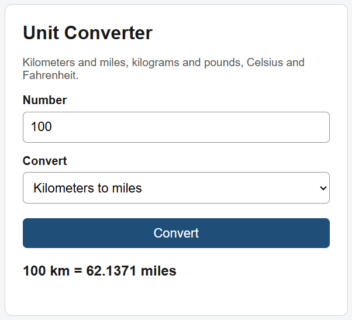

# Unit Converter

A small web page that converts units. It is my individual final project for CMPS 510 (Principles and Concepts of Software Engineering) at Bay Atlantic University.

**Live page:** https://elifayyildiz357.github.io/unit-converter/

## What it does

- Kilometers and miles
- Kilograms and pounds
- Celsius and Fahrenheit

Type a number, choose a conversion, and press Convert. The result is rounded to 4 decimals. If the box is empty or the number is bigger than 1,000,000,000, the page shows an error message instead.

## Screenshot

## How it is built

The whole app is one HTML file with CSS and JavaScript inside. It has no server, no database, and no sign-in, and it does not collect any personal data. The page is published with GitHub Pages.

## Tools used

- GitHub and GitHub Pages, for the repository and for publishing the page
- The GitHub web editor, to edit the files
- An AI assistant (Claude, by Anthropic), which helped me plan the project, write the code, and explain it to me
- My web browser, to test the conversions by hand
